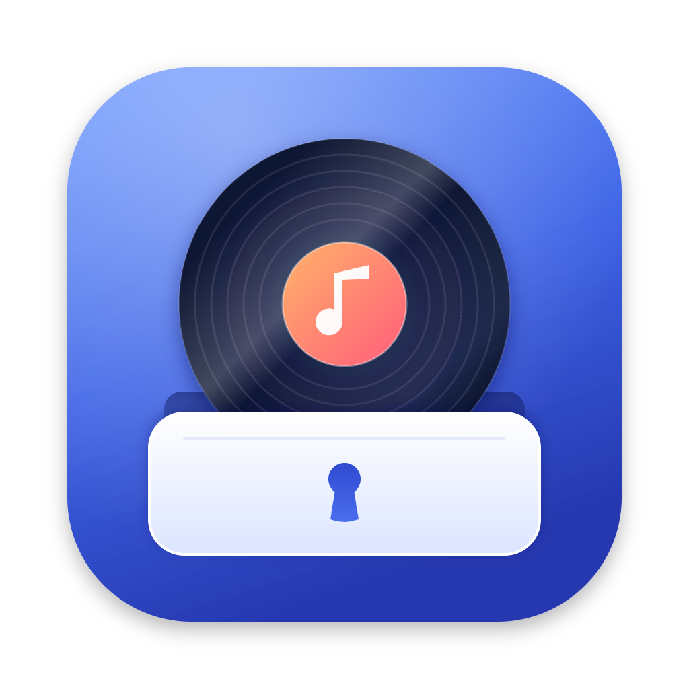
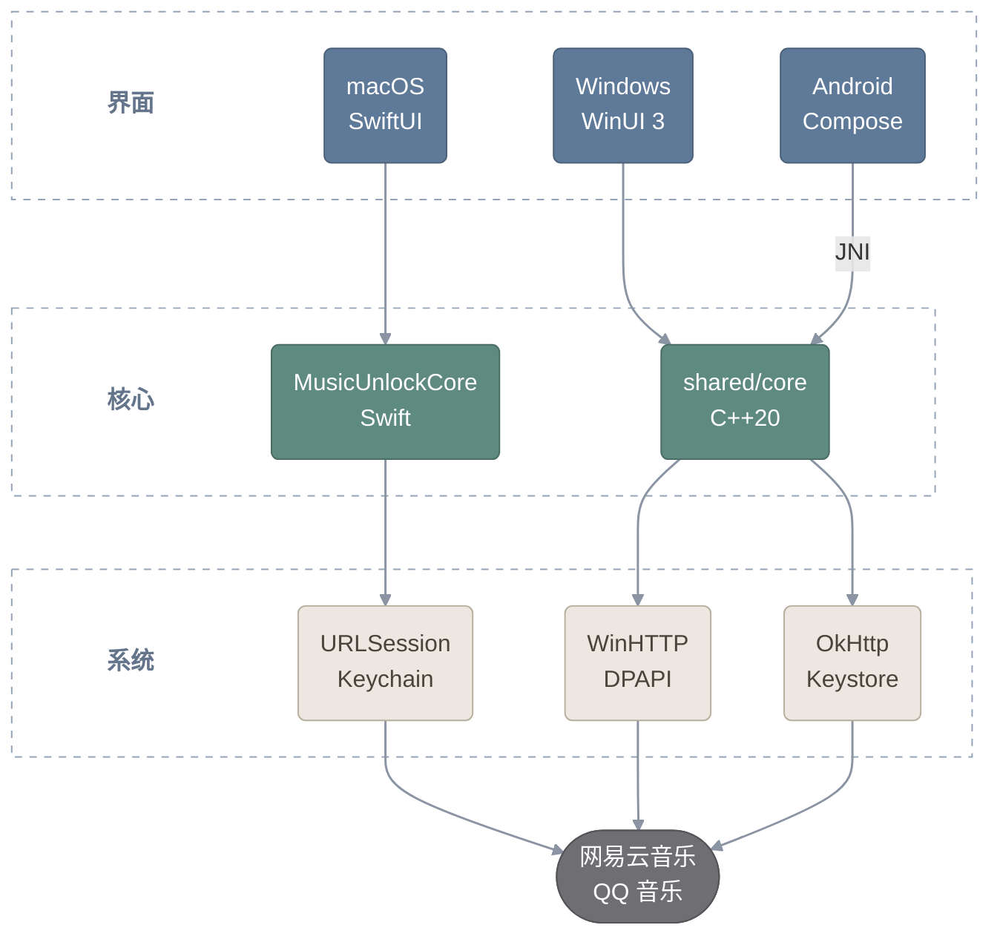

<div align="center">



# 音匣 MusicUnlock

音乐解封装与歌词工具。macOS、Windows 和 Android 版本在同一个仓库维护，各自使用原生界面与系统集成。

[](https://github.com/backspace135/musicunlock/releases?q=v&expanded=true)
[](https://github.com/backspace135/musicunlock/releases?q=windows-v&expanded=true)
[](https://github.com/backspace135/musicunlock/releases?q=android-v&expanded=true)
[](LICENSE)

[平台状态](#平台状态) · [架构](#架构) · [下载](#下载) · [目录结构](#目录结构) · [从源码构建](#从源码构建) · [发布](#发布) · [许可证与来源](#许可证与来源)

</div>

## 平台状态

| 平台 | 最新版本 | 技术 | 入口 |
| --- | --- | --- | --- |
| macOS | [0.3.0](https://github.com/backspace135/musicunlock/releases/tag/v0.3.0) | Swift / SwiftUI / Apple Liquid Glass | [构建与使用说明](apps/macos/README.md) |
| Windows | [0.2.1](https://github.com/backspace135/musicunlock/releases/tag/windows-v0.2.1) | C++20 / C++/WinRT / WinUI 3 | [构建与开发说明](apps/windows/README.md) |
| Android | [0.1.0](https://github.com/backspace135/musicunlock/releases/tag/android-v0.1.0) | Kotlin / Jetpack Compose / C++（NDK） | [构建与使用说明](apps/android/README.md) |

三个平台功能一致：

| 功能 | 说明 |
| --- | --- |
| **音乐解锁** | 本地批量解封装 NCM、QMC、MFLAC、MGG 等音频，保留原有编码，不修改源文件。 |
| **歌词工具** | 网易云音乐 / QQ 音乐搜索，原文、译文、罗马音编辑，导出 LRC / TXT / SRT / VTT。 |
| **账号登录** | 网易云扫码登录、QQ 音乐官方登录页授权，会话用系统密钥加密保存，无需手动复制 Cookie。 |

界面按各平台的原生方式实现：macOS 用 Apple Liquid Glass；Windows 用实色卡片、细描边和柔和投影（WinUI 3 不能对界面内容做自定义模糊），
切换开关、菜单、连续曲率圆角和弹簧动效的参数与 macOS 版一一对应；Android 用 Jetpack Compose，只用黑白灰。

## 架构



## 下载

[最新版本](https://github.com/backspace135/musicunlock/releases/latest)里有三个平台的最新安装包，tag 按日期命名（例如 `2026.11.07`）。
各平台的历史版本和完整更新说明在 [GitHub Releases](https://github.com/backspace135/musicunlock/releases) 里，用各自的 tag：

| 平台 | 各平台 tag | 文件 | 系统要求 |
| --- | --- | --- | --- |
| macOS | `v*` | `MusicUnlock-macOS-arm64.zip` | macOS 26+，Apple Silicon |
| Windows | `windows-v*` | `MusicUnlock-Windows-x64.exe`（单文件，推荐）、`-portable.zip`（目录版）、`musicunlock-cli-Windows-x64.exe`（命令行版） | Windows 10 1809+ / Windows 11，仅 x64 |
| Android | `android-v*` | `MusicUnlock-Android-<版本>.apk` 与 `.sha256` | Android 8.0（API 26）+，仅 arm64-v8a |

安装包不经应用商店分发：macOS 版只有本地 ad-hoc 签名，没有 Developer ID 签名和 Apple 公证；Windows 版没有代码签名，
SmartScreen 可能提示“Windows 已保护你的电脑”，点“更多信息 → 仍要运行”；Android 首次安装需允许「安装未知应用」，升级直接覆盖安装。具体说明见各平台 README 和对应 Release 页面。

## 目录结构

```text
musicunlock/
├── apps/
│   ├── macos/                 macOS App、CLI、Swift 核心库与测试（Swift Package）
│   ├── windows/               Windows 版：WinUI 3 界面、命令行版、单 exe 启动器与打包脚本
│   └── android/               Android 版：Jetpack Compose 界面，:core 模块经 NDK / JNI 调用 shared/core
├── shared/
│   └── core/                  Windows 与 Android 共用的 C++20 核心：解密、标签、歌词、登录会话、平台接口与测试
├── resources/                 公共运行资源（KGM 数据表）
├── tests/fixtures/            跨平台解密测试向量
├── .github/workflows/         Windows 与 Android 的 CI 和发布
├── LICENSE                    项目 MIT 许可证
├── THIRD_PARTY_NOTICES.txt    算法与数据来源、第三方许可
└── README.md
```

macOS 版的解密逻辑是原生 Swift 实现；Windows 版和 Android 版共用 `shared/core` 的 C++ 核心，平台目录只放界面和系统集成
（文件、网络、凭据保护）。三个平台用 `tests/fixtures/` 里同一组测试向量验证，Windows 版与 macOS 版输出逐字节一致。

平台源码、测试和打包脚本归各自目录管理。构建产物写入对应平台的 `build/`，不提交到 Git。
仓库不保留上游参考源码，仅保留必需数据和测试向量；克隆后即可构建。

## 从源码构建

### macOS

需要 macOS 26+、Xcode 26+。在 `apps/macos/` 目录运行：

```sh
python3 scripts/build-app.py         # 产物：build/音匣.app 和 build/MusicUnlock-macOS-arm64.zip
swift test --build-system native     # 测试
python3 scripts/smoke-test.py
```

真实平台接口检查、登录方式、支持格式和功能限制见 [macOS README](apps/macos/README.md)。

### Windows

需要 Visual Studio 2022 Build Tools（“使用 C++ 的桌面开发”）与 Python 3，不需要 Visual Studio IDE。在 `apps/windows/` 目录运行：

```sh
python scripts/build.py              # 核心、命令行版与启动器，并运行测试和冒烟测试
python scripts/build_app.py          # WinUI 3 界面
python scripts/pack.py               # 生成单文件 build/dist/MusicUnlock.exe
```

单 exe 内嵌压缩后的自包含 WinUI 3 程序目录，首次运行解压到 `%LOCALAPPDATA%\MusicUnlock\runtime\`，用户无需安装
.NET 或 Windows App Runtime。界面设计、界面预览与动效记录、分发目录、任务栏固定等细节见 [Windows README](apps/windows/README.md)。
安装版与文件关联（#10）尚未实现。

### Android

需要 Python 3.10+、JDK 21 和 Android SDK；NDK、CMake、build-tools 的版本固定在 `apps/android/gradle/libs.versions.toml`，
由 `setup_toolchain.py` 安装。在仓库根目录运行（Windows 用 `python`）：

```sh
python3 apps/android/scripts/setup_toolchain.py
python3 apps/android/scripts/build.py                   # debug APK、单元测试与主机上的核心测试
python3 apps/android/scripts/build.py --release         # 签名的 release APK（需要发布证书）
python3 apps/android/scripts/device.py --help           # 安装到设备和调试
```

架构、核心的 Kotlin API、签名与发布流程见 [Android README](apps/android/README.md)，界面规范见
[DESIGN.md](apps/android/DESIGN.md)。

## 发布

GitHub 只把一个 Release 标成 Latest，仓库首页也只显示这一个，所以分两步：

1. 各平台照旧用自己的 tag 发布正式版（`v*`、`windows-v*`、`android-v*`，见各平台 README）。
2. 在仓库根目录运行 `scripts/release.py`，把每个平台最新的正式版汇总成一个总 Release 并标成 Latest：

```sh
python3 scripts/release.py              # 试运行：下载到 build/release/<tag>/，按 GitHub 记录的 SHA-256 校验，生成说明 notes.md
python3 scripts/release.py --publish    # 创建总 Release，tag 默认是今天的日期（UTC+9），同一天再发一次用 2026.11.07.1
```

总 Release 带上所有安装包、Android 的 `.sha256` 和汇总的 `SHA256SUMS.txt`，说明里列出各平台版本、更新内容与安装提示。
带后缀的测试 tag（例如 `android-v0.1.0-rc1`）、草稿和预发布不会被汇总。

## 许可证与来源

本项目自行编写的代码采用 [MIT 许可证](LICENSE)。

音频解密算法移植自 Unlock Music，原生运行不调用上游 TypeScript。KGM 数据与解密测试向量保留在
[resources/](resources/README.md) 和 [tests/fixtures/](tests/fixtures/README.md)。
上游 MIT 许可和衍生 TEA 代码的 BSD-3-Clause 声明均保留在 [THIRD_PARTY_NOTICES.txt](THIRD_PARTY_NOTICES.txt)，并随 App 分发。
`shared/core` 使用的第三方库（nlohmann/json、QR-Code-generator 等）及其许可同样列在该文件中。

歌词工作流参照 [MusicLyricApp](https://github.com/maqianjun-1/MusicLyricApp) 独立实现；未包含其 Windows 可执行文件、反编译源码或 DLL。
